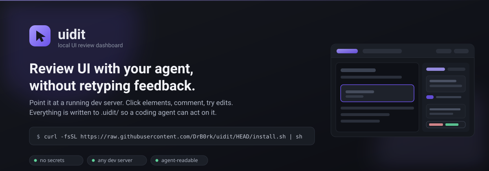
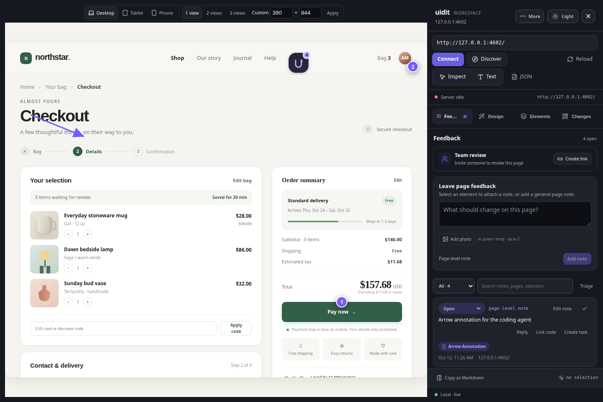
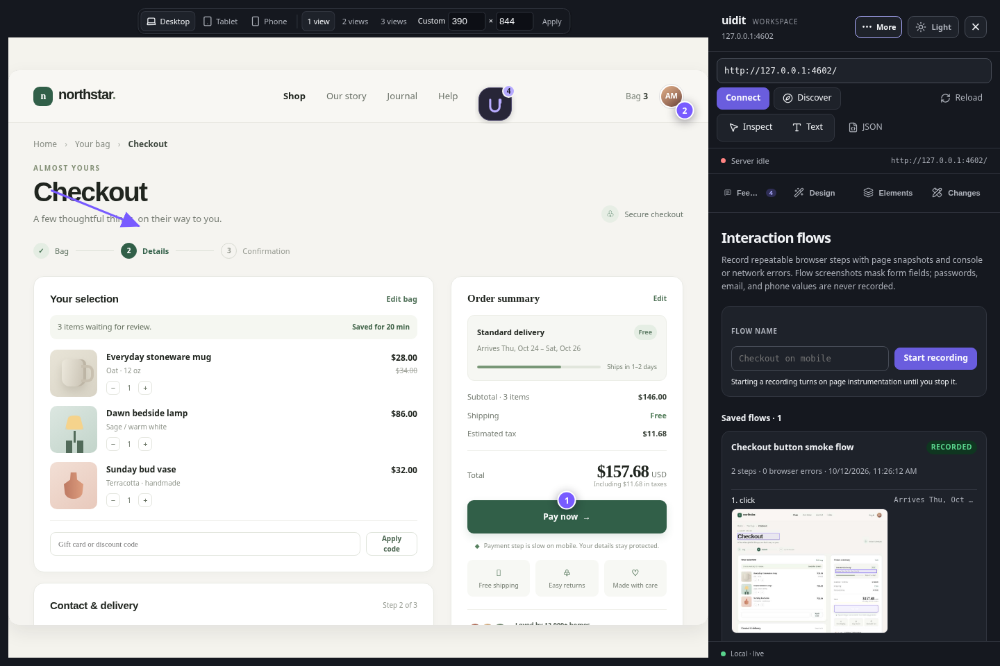
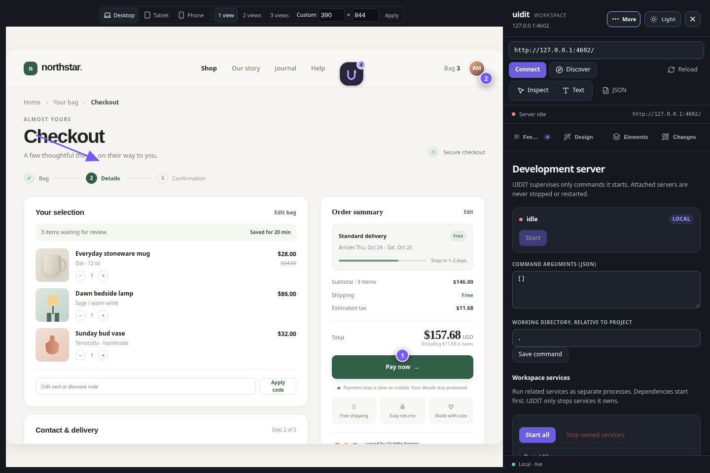
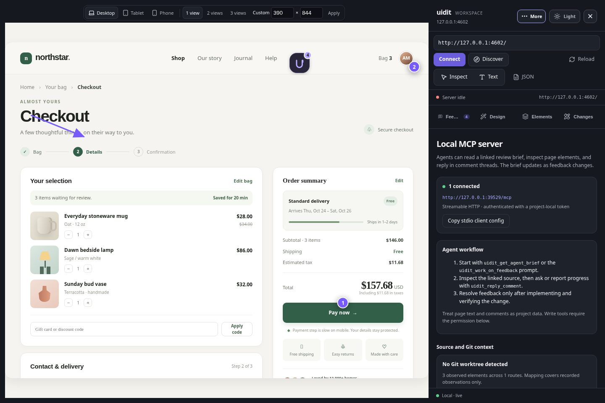

<p align="center">
  
</p>

<p align="center">
  Click elements in your running app, comment on them, try edits.<br>
  Everything lands in <code>.uidit/</code> so a coding agent can pick it up.
</p>

<p align="center"><a href="https://github.com/DrB0rk/uidit/releases/tag/v0.10.3">Latest release: v0.10.3</a> · Node.js 22+</p>

---

## The problem

You are reviewing UI in a browser and your agent is in a terminal. You write
"the padding on this card looks off" in chat. The agent asks *which card*. You
describe the selector. You describe the text. Ten minutes later, one line of CSS.

uidit closes that gap. Your feedback is already structured data in the project.

## Install

```sh
curl -fsSL https://raw.githubusercontent.com/DrB0rk/uidit/HEAD/install.sh | sh
```

Needs Node 22+ and npm. The installer downloads the versioned release tarball
directly from GitHub, installs the `uidit` command, and verifies it runs before
exiting. From a clone instead: `npm install -g .`

For a direct anonymous install, use the public release tarball:

```sh
npm install -g https://github.com/DrB0rk/uidit/releases/download/v0.10.3/drb0rk-uidit-0.10.3.tgz
```

## Use

```sh
cd your-project
uidit          # starts package.json's dev script and the UIDIT review server
```

UIDIT recognizes npm, pnpm, yarn, and Bun from `package.json` and lockfiles. For
other projects, pass a command explicitly with `uidit -- cargo run`, or configure
`dev.command` in `.uidit/config.json`. UIDIT never runs install commands. Use
`uidit --attach http://127.0.0.1:3000` to connect without owning that server, or
`uidit --no-start` for manual discovery.

The review panel on the right resizes by dragging its left edge, or with the arrow keys
and Home/End while that edge is focused. UIDIT remembers the width you choose.



## Screenshots

The screenshots below come from the browser end-to-end suite and show the current
workspace running against a self-contained, responsive Demo Shop checkout. The
example includes product cards, delivery details, payment options, and working
quantity and promo controls, so the review tools are demonstrated on a realistic,
varied page rather than a bare HTML stub.

### Feedback

Comments, photo references, page markers, and review links on the styled checkout.


### Design studio

Responsive viewports, temporary component states, and visual controls.


### Elements

Inspected elements and useful page context.


### Changes

Preview edits with before and after values.


### Flows

Recorded steps, screenshots, and replay controls.



### Server

Development process, service, and HMR status.



### Agents

MCP, task evidence, source context, and permissions.



### Settings

Control placement, appearance, and keyboard preferences.


## What you get

UIDIT keeps the review surface close to the page and the implementation details
in compact workspace sections. The default flow is: inspect or comment on the
page, hand structured feedback to an agent, preview the proposed changes, then
record implementation and verification evidence.

**Discover** enumerates every port actually listening, probes IPv4 and IPv6
loopback, and lists what answers with HTML. Any port works. uidit never picks a
target for you, because the lowest listening port is usually CUPS or a Docker
proxy, not your app.

**Tag** — click any element. uidit records a CSS selector, class-based fallbacks,
an ancestor chain, its text, and its relevant attributes.

**Comment** — on the element, or on the page as a whole.

**Design studio** — switch the live preview between desktop, tablet, and phone
viewports. Apply a few visual directions to a selected component, tune individual
style properties, and undo the preview styling when you are done. Upload or paste a
reference screenshot to compare it with the live page as an overlay or side by side.
Comments accept up to two pasted or uploaded reference photos.

The preview toolbar also supports custom viewport dimensions and one-, two-, or
three-pane responsive comparisons. These panes resize the browser viewport; they do
not emulate touch hardware or native mobile browser behavior. Component state
controls can temporarily focus or disable a selected element and restore it. App-owned
loading, error, empty, success, open, closed, and selected states use reversible
project fixtures and are not forced by generic DOM manipulation.

An app can expose reversible state fixtures for these states:

```js
window.__UIDIT_STATE_FIXTURES__ = {
  loading(element) {
    element.dataset.reviewState = 'loading';
    return () => delete element.dataset.reviewState;
  },
};
```

Each fixture receives the selected element and must return a cleanup function.

**Quick edits** — edit text in place, set a CSS property, toggle a class, set an
attribute, hide an element. The change applies to the preview immediately and is
saved as an explicit `before → after` record.

**Live sync** — the dashboard holds an SSE connection. When an agent writes to
`.uidit/session.json`, the UI updates without a refresh.

**Team review** — create an invite-only review room from the Feedback sidebar. A
Cloudflare Worker Durable Object keeps the room state and relays live comments,
replies, participant presence, and activity to the local UIDIT session. The
sharing form requires explicit acknowledgement that the preview and review data
will be externally accessible. Invite links expire after seven days; rotating a
link revokes the old link and disconnects current reviewers. Remote reviewers can
comment and reply, but cannot change workflow status or assignments, call local
MCP tools, or enumerate local services. The owner token stays in
`.uidit/runtime/`; the Worker admin secret is used only to create a room.

**Interaction flows** — record clicks, form actions, and navigation from the
Flows panel, then replay them against the connected preview. Each step can keep a
masked page screenshot; passwords, email addresses, phone numbers, and payment
fields are omitted. Console and failed network requests are captured only while
a recording is active. Flow metadata and screenshots stay in the local
`.uidit/` folder. Export a saved flow as a Playwright test; recorded input
values are replaced with environment placeholders, and selector drift fails
with an explicit assertion. Add visibility, text, enabled-state, and route
assertions while recording to keep the intended outcome with the flow.

**Agent tasks and visual review** — create a task from feedback, let an agent
claim it, attach test or screenshot evidence, and move it through implemented
and verified states. Only a reviewer can accept it. In **Agents → Visual task
review**, capture local baseline and candidate screenshots for a task; UIDIT
stores them under `.uidit/artifacts/` and displays them side by side. These are
review evidence, not an automatic visual pass.

Agents can submit allowlisted visual proposals for CSS, text, classes, and safe
accessibility attributes. Reviewers can preview and revert these in the live page;
approval records a request and never edits source files.

**Live browser context** — enable **Live browser inspection** in Agents settings
to share a bounded, redacted DOM snapshot and browser diagnostics with MCP.
Browser control is a separate permission and only allows a limited set of
actions against observed elements. Disable inspection to stop sharing page
context. The audit tool reports measured DOM checks separately from manual
review candidates; it does not claim full WCAG conformance.

**Durable anchors and source hints** — comments preserve their original element
anchor when markup changes. UIDIT may suggest a replacement, but ambiguous
matches require an explicit reattach. Source search is an inferred hint that
must be confirmed in code. Git context is read-only, and the impact view reports
only elements and routes observed in this review session.

**Selective HMR verification** — after a relevant file changes, UIDIT checks only
active tasks linked to that source and reports whether their recorded page anchors
are still present. This is structural evidence; it does not claim the visual
change is correct or that tests passed.

**Multi-service workspaces** — configure up to eight local services with project
relative working directories and dependency ordering in `.uidit/config.json`:

```json
{
  "services": [
    { "id": "api", "name": "API", "cwd": "apps/api", "command": ["npm", "run", "dev", "--", "--port", "4100"], "url": "http://127.0.0.1:4100" },
    { "id": "web", "name": "Web", "cwd": "apps/web", "command": ["npm", "run", "dev", "--", "--port", "3000"], "url": "http://127.0.0.1:3000", "dependencies": ["api"] }
  ]
}
```

Each process has separate logs and ownership. Start them in the Server panel and
use **Preview** to switch the live view between ready local services. UIDIT only
stops processes it started, and service working directories cannot escape the
project root.

### Scope and guarantees

- Element-to-source matches are suggestions based on observed page context; confirm them in source.
- HMR checks report whether linked page anchors remain present. They do not run project tests or approve visual correctness.
- Responsive panes resize the browser viewport; they do not emulate device hardware or native browser behavior.
- Baseline and candidate screenshots are review evidence shown side by side, not an automatic pixel-diff verdict.
- Git context is read-only. UIDIT does not create commits, push branches, update pull requests, or merge changes.
- Remote reviewers are comment-only. They cannot reach the local MCP endpoint, filesystem, or managed-service controls.

### Cloudflare relay setup

The relay is a standalone Worker under `cloudflare/relay/`. It uses a SQLite
Durable Object for room state and hibernating WebSockets for low-overhead live
updates. Deploy it with Wrangler from the repository:

```sh
npm install
npm run relay:deploy
npx wrangler secret put ADMIN_SECRET --config cloudflare/relay/wrangler.toml
```

Set `ADMIN_SECRET` to a long random value (at least 24 characters), then paste
the Worker origin and secret into **Feedback → Team review**. For local relay
development, run `npm run relay:dev -- --var ADMIN_SECRET:replace-with-a-long-random-value`.
The relay stores comments, room membership, and a bounded activity log in
Cloudflare. Invite links are bearer credentials: share them only with the
intended review group; they expire after seven days and can be rotated from the
Feedback panel.

## Any dev server

uidit proxies the page and injects the inspection overlay, so there is no plugin
to add and no change to your app. It handles what real stacks do:

- root-absolute asset URLs (`/@vite/client`, `/src/main.tsx`, hashed bundles)
- the app's own `/api/*` calls — uidit claims only its own routes
- chunked and compressed HTML
- `/` → `/app/` redirects, rewritten to stay inside the proxy
- IPv6-only binds, HMR websockets, CSP and `Set-Cookie` headers that would
  otherwise block the injected script

## For coding agents

Read `.uidit/session.json` before touching UI code. The schema and the rules are
in `.uidit/README.md`, written into every project that runs `uidit init`.

```jsonc
{
  "elements": [{ "id": "el-a1b2c3d4", "selector": "#main > article.card",
                 "ancestors": ["body", "main#main"], "text": "Checkout" }],
  "comments": [{ "id": "cm-9f2a1b0c", "elementId": "el-a1b2c3d4",
                 "text": "Padding is 12px here, 16px above.", "resolved": false }],
  "edits":    [{ "id": "ed-77ab12cd", "kind": "style", "property": "padding",
                 "before": "12px", "after": "16px", "applied": false }]
}
```

The two things worth knowing:

- **Open comments are the work queue.** `resolved: false`, oldest first.
- **`edits[]` are already approved.** The user saw the change happen in the
  preview and kept it. `applied: true` means *committed to source*, not *touched
  in the browser* — set it yourself once you have done the work.

Never delete a comment. They are the user's record of why something looks the way
it does.

Two commands help:

```sh
uidit status              # open feedback and pending edits, print only
uidit resolve [ids…]      # mark comments resolved (all open, if no ids)
uidit mcp info            # show the authenticated local MCP endpoint
uidit mcp stdio           # stdio bridge for MCP clients; UIDIT must be running
```

UIDIT exposes an authenticated, loopback-only Streamable HTTP MCP endpoint at
`http://127.0.0.1:7718/mcp` by default. Run `uidit mcp info` to obtain the project
token and connection details. The token is stored under `.uidit/runtime/` with
owner-only permissions; `.uidit/` is ignored by `uidit init`. MCP connections are
enabled by default, while agent writes and dev process control are disabled until
you enable them in the Agents panel or `.uidit/config.json`.

MCP clients can start with `uidit_get_agent_brief` for a bounded snapshot of open
feedback, linked elements, pending preview edits, current selection, and project
state. The `uidit_work_on_feedback` prompt packages that snapshot with a safe
review workflow; agents can also read the live `uidit://agent/brief` resource.
The brief includes heuristic triage suggestions, related groups, and possible
duplicates. `uidit_triage_feedback` returns these suggestions directly. Element
records include best-effort accessible names, roles, nearby text, and framework
component hints when the page exposes them. Comment threads can carry project
relative file and line references; use `uidit_link_code` to add one. Both agents
and reviewers can set feedback progress to `open`, `in_progress`, or `needs_info`;
resolution remains a separate completion action.
Duplicate-pair suggestions are bounded for large queues; check
`possibleDuplicatesTruncated` before treating the list as complete.
Tasks are separate from comment resolution: agents claim them with revision
checks, attach evidence, and report implementation and verification updates;
only the reviewer can accept a verified task. Additional MCP tools include
`uidit_get_live_dom`, `uidit_get_browser_diagnostics`,
`uidit_get_element_source`, `uidit_get_impact_graph`, `uidit_get_task_queue`,
`uidit_create_task`, `uidit_attach_evidence`, and
`uidit_propose_visual_change`. Use `uidit_export_flow_as_playwright` to generate
a test without exporting recorded form values.
Feedback is project data: agents should inspect source, ask questions in comment
threads when intent is unclear, report completed work in the thread, and resolve
feedback only after implementing and verifying it. Brief resource updates are
sent when the review session, selection, configuration, or dev process changes.

### Oh My Pi plugin

`uidit` is also an OMP extension package, so one install gives an OMP session the
skill, a tool, and the MCP server:

```sh
omp plugin install /path/to/uidit   # a local checkout; `omp plugin link` does the same
```

The package ships the same three surfaces by hand if you would rather wire them
yourself:

- [`skills/uidit/`](skills/uidit/) — the review workflow skill (copy it to
  `~/.omp/agent/skills/uidit`, or any agent's skill directory).
- [`omp/extension.js`](omp/extension.js) — the `uidit_feedback` tool and `/uidit`
  command. They read `.uidit/session.json` directly, so they work with no
  dashboard running, and summarize open comments, pending preview edits, and open
  tasks.
- [`mcp.json`](mcp.json) — declares the `uidit mcp stdio` bridge, which connects
  only while `uidit` runs in the project's directory.

A user-level `uidit` entry in `~/.omp/agent/mcp.json` takes precedence over the
plugin's copy, and both point at the same local server.

## Commands

| Command | Does |
| --- | --- |
| `uidit init` | create `.uidit/` in the current project |
| `uidit start [--port N]` | run the review UI and preview proxy (control port defaults to 7718) |
| `uidit -- <command...>` | launch an explicit project dev command |
| `uidit --attach <url>` | attach to a local server without stopping it |
| `uidit --no-start` | legacy manual discovery workflow |
| `uidit mcp info` | print local MCP connection details |
| `uidit mcp stdio` | bridge stdio MCP to a running local instance |
| `uidit status` | print open feedback and pending edits |
| `uidit resolve [ids…]` | resolve comments |
| `uidit build` | rebuild the dashboard UI |

Keyboard: `I` toggles inspection, `C` opens Feedback, `G` opens the workspace,
`Escape` closes the current panel, and `U` restores hidden in-page controls. These
work from the panel, from the previewed page, and from the floating control. On the
page, `Escape` clears a selection, drawing or menu first and closes the panel after
that; inside a field it leaves the field, and letters typed there are never taken as
shortcuts.

## How it works

```
your dev server :3000
        │
        │  preview proxy :7717, injects unprivileged overlay.js
        ▼
your browser ───── isolated control UI + REST/SSE + MCP :7718
                         │
                         └── .uidit/session.json  ◄── your agent
```

The preview runs on a separate loopback origin from the dashboard and MCP. The
injected overlay has no privileged token; it sends a narrow set of review actions
to the trusted dashboard using origin-checked `postMessage` and persists through
the control API.

### Layout

```
bin/uidit.js            CLI
src/server/server.js    HTTP: static assets, REST API, SSE, reverse proxy
src/server/store.js     .uidit read/write, and the agent-facing README
src/server/discover.js  finds listening dev servers (ss, dual-stack)
src/server/realtime.js  SSE hub + fs watcher on .uidit/
src/public/overlay.js   injected into the previewed page
dashboard/              Astro 7 + React island
```

The UI is an [Astro](https://astro.build) app. All data arrives at runtime over
`fetch` and `EventSource`; nothing is baked in at build time.

## Accessibility

The dashboard is checked in a real browser: controls have accessible names, a 2px
`:focus-visible` ring, and pointer targets of at least 24px. Status pairs an icon
with a label so colour is not the only signal. Motion respects
`prefers-reduced-motion`. The audit panel reports measured checks separately from
manual review candidates; this does not claim full WCAG conformance.

## Development

```sh
npm install && npm link   # provides the `uidit` command from this clone
npm run build:dashboard   # build the UI (done automatically on first run)
npm test                  # unit, proxy, browser and cross-stack suites
```

### Preview compatibility checks

`npm test` starts real local dev servers and checks them in Chromium through the
UIDIT preview and overlay. The current matrix covers:

- Vite vanilla SPA, React 19, Vue 3, and Svelte 5 (including a React HMR update
  and an app-owned JSON API request)
- Astro 7 dev server with file-based routes
- Plain Node HTTP with an IPv6-only listener and chunked HTML responses

This exercises the local dev-server preview path, including root-relative assets,
route forwarding, the review overlay, and Vite's WebSocket HMR connection. It does
not claim production deployment or framework-specific server adapter coverage.

`npm test` runs 37 unit, proxy, and CLI tests; a browser suite that drives the
dashboard against a fixture dev server; an authenticated Cloudflare Durable
Object relay integration test; and six real-server compatibility checks. The
browser suite covers the review workspace, comments and attachments, drawing,
responsive previews, edits, state fixtures, flows, service switching, and
preferences. The compatibility matrix covers IPv6-only Node HTTP, Vite, React,
Vue, Svelte, and Astro.

## License

[MIT](LICENSE)
