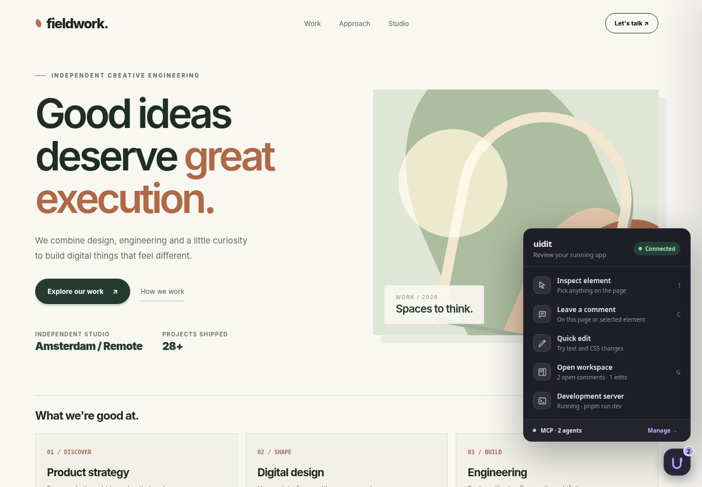
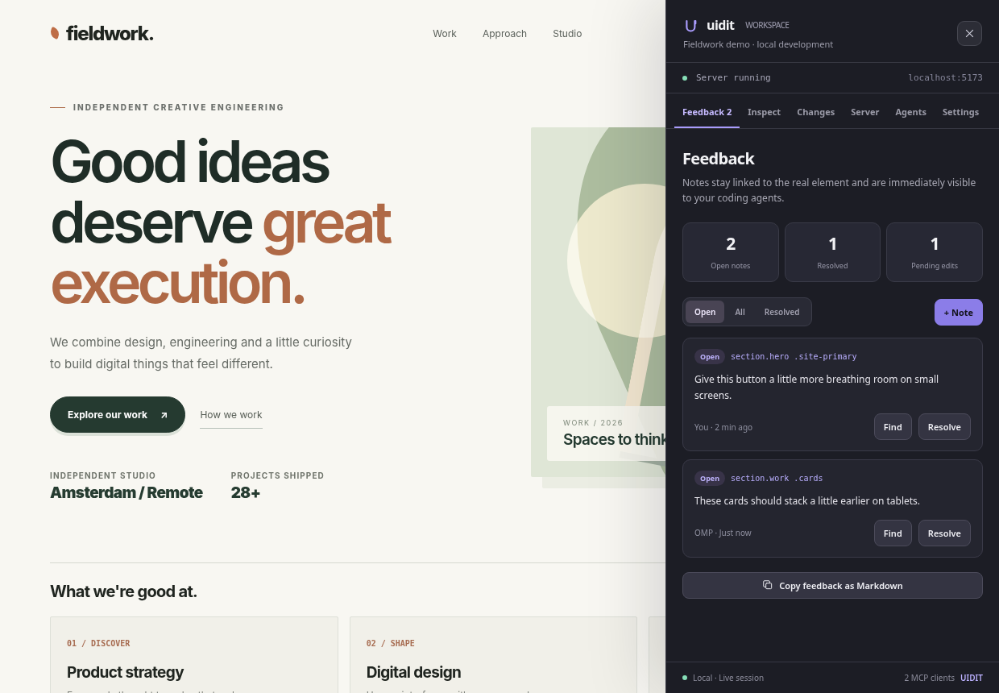
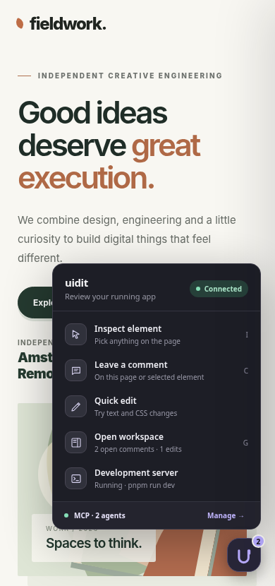
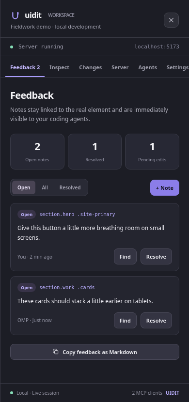

# UIDIT interactive in-page UI mockup

This folder contains a **standalone, interactive design concept**, not production application code.

## Try the prototype

1. Download or clone the repository.
2. Open [uidit-interactive-mockup.html](./uidit-interactive-mockup.html) in a browser.
3. Click the compact UIDIT control at the bottom-right of the sample webpage.
4. Try the action popover and **Open workspace** drawer.
5. Enable inspect mode and select a page element to leave feedback or preview edits.
6. Explore Feedback, Inspect, Changes, Server, Agents and Settings.

The page is self-contained (inline CSS and JavaScript, no build step). **Server processes and MCP clients are simulated**, as are live agent messages; this is a UX prototype only. The UI demonstrates the proposed in-page workflow without connecting to a real development server or MCP endpoint.

## Screenshots

### Desktop

**Collapsed floating button and action popover**

**Expanded slide-out management drawer**

### Mobile

| Floating actions | Review drawer |
| --- | --- |
|  |  |

## Implementation architecture

For universal dev-server orchestration, reverse-proxy design, security boundaries, and local MCP tools with real-time subscriptions, see [the integrated implementation plan](../plans/INTEGRATED_DEV_SERVER_MCP_INPAGE_UI.md).
